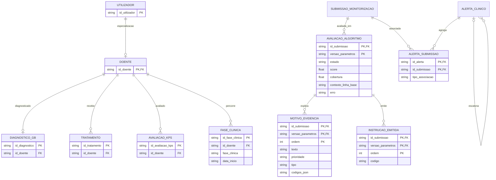
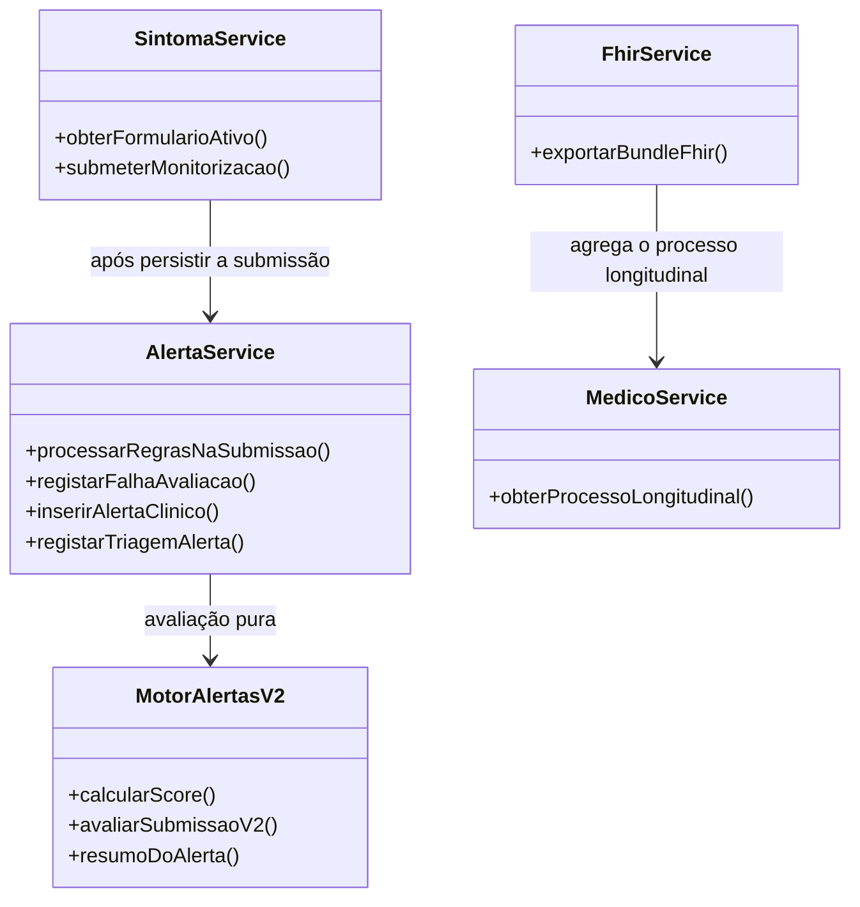

# Modelos e dicionário de dados

O inventário completo de tabelas e colunas, domínios, relações e semântica de nulos está em [Dicionário de dados](./dicionario-de-dados.md).

## Arquitetura implementada

O runtime usa Express e SQLite através de `better-sqlite3`, com SQL parametrizado nos serviços. Não há TypeORM nem camada de repositórios. As regras executáveis e pesos estão em `src/services/motor-alertas-v2.ts`; a base de dados guarda o catálogo descritivo de regras. Não existe uma operação `reprocessar()`. As rotas implementadas estão em `src/routes/api.routes.ts`, incluindo `/doentes/:idDoente/submissoes`, `/alertas/:idAlerta/triagem` e `/fhir/Patient/:idDoente/$everything`.

## Modelo físico — avaliação e alertas

`AvaliacaoAlgoritmo` é imutável, identificada por `(id_submissao, versao_parametros)` e não apaga em cascata quando uma submissão é removida. As tabelas `MotivoEvidencia` e `InstrucaoEmitida` têm FK composta para essa chave e triggers que impedem atualização e remoção. Uma avaliação com falha usa `estado = 'ERRO'`, guarda a mensagem em `erro` e não simula score ou prioridade.

`AlertaSubmissao.tipo_associacao` distingue a origem, um motivo repetido, um motivo novo e um escalonamento. `AlertaClinico.id_alerta_anterior` liga alertas escalonados ao alerta aberto que os antecedeu. A comparação de deduplicação usa o motivo (tipo, códigos e descrição normalizada), e não apenas o tipo amplo da regra.

Na implementação atual, `Utilizador` é a tabela-base de perfis e `Doente` é uma especialização por PK/FK. `Tratamento` liga-se diretamente a `Doente`, não a `DiagnosticoGB`.

## Rastreabilidade

| Requisito | Tabelas e controlos implementados |
|---|---|
| RNF03 | `AvaliacaoAlgoritmo`, `MotivoEvidencia`, `InstrucaoEmitida`; chave composta por submissão/versão, FKs e triggers de imutabilidade |
| RNF09 | `AvaliacaoAlgoritmo`, `MotivoEvidencia`, `InstrucaoEmitida`; persistência de estado/erro, integridade referencial e triggers de imutabilidade |

Os identificadores RNF03/RNF09 foram mantidos conforme a lista de requisitos fornecida; a definição normativa completa desses requisitos não está neste repositório.

## Diagrama de classes — responsabilidades

## Modelo conceptual

Doente ou cuidador autorizado submete respostas. O motor produz avaliação, motivos e instruções; a equipa profissional (enfermagem ou medicina) triage o alerta e decide a ação clínica. A prioridade algorítmica e a decisão/prioridade humana são guardadas separadamente. A linha de base é um dado derivado das submissões comparáveis, não uma medição editável.

## Semântica dos nulos e ausências

| Dado | Representação | Significado |
|---|---|---|
| Resposta «Não tive» | Linha existente, `valor_numerico = 0`, `motivo_nao_avaliavel = 0` | Sintoma ausente / nível basal zero |
| Resposta ordinal positiva | Linha existente, valor numérico positivo, flag 0 | Nível efetivamente indicado |
| «Não consigo avaliar» | Linha existente, `valor_numerico = NULL`, `motivo_nao_avaliavel = 1` | Resposta fornecida, mas não avaliável |
| Pergunta omitida | Sem linha em `RespostaMonitorizacao` | Sem resposta; não equivale a zero nem a «não avaliável» |
| KPS sem avaliação vigente | `NULL` no resumo/avaliação | Não há KPS anterior ou a avaliação tem mais de 180 dias na data de referência |
| Prioridade algorítmica nula | `AvaliacaoAlgoritmo.prioridade_algoritmo = NULL` | A avaliação concluiu sem motivos de alerta; não é uma prioridade humana |
| Falha do motor | `estado = 'ERRO'`, score e cobertura nulos, texto em `erro` | A submissão continua guardada, mas não há avaliação clínica automática |

O score usa os pesos propostos 3/2/1 e o limiar atual `max(5, 0,1 × S₀, 2 × MAD)`. A cobertura mínima é 60%. Os parâmetros são exploratórios e não validados clinicamente.
